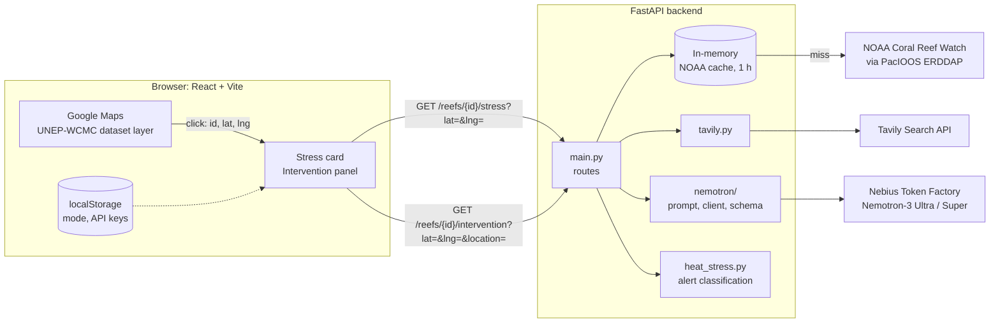
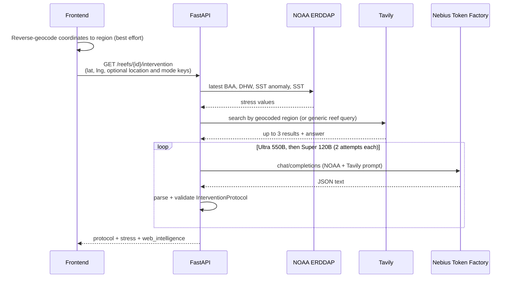

# Architecture

ThermoReef connects live NOAA Coral Reef Watch telemetry, regional Tavily search, and NVIDIA Nemotron hosted on Nebius Token Factory in an end-to-end reef intervention pipeline.

## Overview

## Frontend (`frontend/`)

React + TypeScript + Vite.

- **Map:** Google Maps via `@vis.gl/react-google-maps`.
- **Reef polygons & IDs:** UNEP-WCMC global coral reef dataset hosted in Google Maps Datasets and rendered with `getDatasetFeatureLayer` ([ReefDatasetLayer.tsx](frontend/src/components/map/ReefDatasetLayer.tsx)). Clicking a polygon selects its dataset `OBJECTID`, highlights it, and provides the click coordinates (`lat`, `lng`).
- **Geocoding:** reverse geocoding via `google.maps.Geocoder` with in-memory caching to resolve clicked coordinates to country and region name ([geocoding.ts](frontend/src/utils/geocoding.ts)).
- **Metric tooltips:** `[i]` popups explaining NOAA satellite metrics (SST, DHW, Anomaly, Alert Level) in [NoaaStressMetrics.tsx](frontend/src/components/map/NoaaStressMetrics.tsx).
- **Stress card:** on reef selection, requests `/reefs/{id}/stress?lat=&lng=`; users can request the nearest valid ocean pixel within 15 km if the clicked point is masked.
- **Intervention panel:** on "Inspect Reef", reverse-geocodes the selected location and requests `/reefs/{id}/intervention` with coordinates and an optional region; displays Shading, Biological Triage, Monitoring, and Web Intel tabs.
- **API credentials:** credentials can be supplied from Settings or loaded from the backend environment:

| Configuration | Request to backend |
|---|---|
| Settings | `x-nebius-key`, `x-tavily-key` headers |
| Backend environment | no key headers; backend uses `NEBIUS_API_KEY` and `TAVILY_API_KEY` from `backend/.env` |

API base URL: `VITE_API_BASE` (default `http://localhost:8000`).

## Backend (`backend/src/backend/`)

FastAPI, HTTPX, Pydantic, managed with `uv`.

| File | Purpose |
|---|---|
| `main.py` | Routes, NOAA request proxy, CORS |
| `constants.py` | URLs, timeouts, model names, `.env` loading |
| `heat_stress.py` | NOAA alert status classification |
| `tavily.py` | Tavily search for regional reports |
| `nemotron/client.py` | Nebius API call with retry and fallback model |
| `nemotron/prompts.py` | System prompt (JSON schema) and user prompt builder |
| `nemotron/schemas.py` | Pydantic schema used to validate the protocol |

### Endpoints

| Method | Path | Description |
|---|---|---|
| GET | `/reefs/{id}/stress?lat={lat}&lng={lng}[&nearest=true]` | NOAA thermal stress for clicked coordinates; optional nearby ocean-pixel lookup |
| GET | `/reefs/{id}/intervention?lat={lat}&lng={lng}[&location={region}]` | Intervention protocol and web intelligence; accepts `x-nebius-key` and `x-tavily-key` |
| GET | `/config/dev-check` | Whether `NEBIUS_API_KEY` and `TAVILY_API_KEY` are set in `.env` |
| GET | `/api/health` | Health check |

## Request Flow

### `/reefs/{id}/stress`

1. Receive clicked coordinates (`lat`, `lng`) directly from Google Maps.
2. Query NOAA ERDDAP `dhw_5km` (PacIOOS) for the latest `CRW_BAA`, `CRW_DHW`, `CRW_SSTANOMALY`, `CRW_SST` at that ocean point.
3. If land mask encountered and `nearest=true`, search adjacent unmasked ocean pixels within 15 km.
4. Derive alert status from BAA and DHW: `alert2` at BAA ≥ 4 or DHW ≥ 8; `alert1` at BAA ≥ 3; `warning` at BAA ≥ 2 or DHW ≥ 4; `watch` at BAA ≥ 1; otherwise `normal`.
5. Cache result in memory for 1 hour per rounded coordinate and lookup mode.

Errors: `400` if coordinates are missing; `404` if NOAA has no ocean value for the pixel; `502` if NOAA is unreachable.

### `/reefs/{id}/intervention`

1. Get NOAA stress data (same as above).
2. Tavily searches by geocoded region or a generic reef query, returning up to 3 results and an optional answer.
3. Build prompt from NOAA values and Tavily results.
4. Call `chat/completions` on Nebius Token Factory:
   - primary model `nvidia/Nemotron-3-Ultra-550b-a55b`;
   - on failure, fallback model `nvidia/nemotron-3-super-120b-a12b`;
   - 2 attempts per model, 2 s delay on HTTP 503.
5. Strip markdown fences, parse JSON, validate against `InterventionProtocol` (Pydantic). Invalid JSON or schema mismatch counts as a failed attempt and triggers retry / fallback model.
6. Return the protocol together with stress data and Tavily results.

Errors: `400` for missing or rejected API keys; `502` for NOAA, Tavily, or Nebius upstream failures.

## Protocol Format

Defined in `nemotron/prompts.py` and `nemotron/schemas.py`:

- `urgency_level`, `intervention_window`, `executive_summary`
- `shading`: method, target hours, expected cooling, priority
- `triage`: species at risk, donor relocation, action items
- `antioxidant_or_feeding`: nutritional or feeding guidance
- `monitoring`: survey frequency, tools, ranger alert text

`reef_id`, `model_used`, and `generated_by` are set by the backend, not by the model.

## API Keys

- User keys are stored in the browser `localStorage` and sent as request headers. The backend does not store them.
- Without headers, the backend uses `NEBIUS_API_KEY` and `TAVILY_API_KEY` from `backend/.env`.
- `/config/dev-check` checks whether the developer keys are present; actual authentication is verified by the upstream services during requests.
