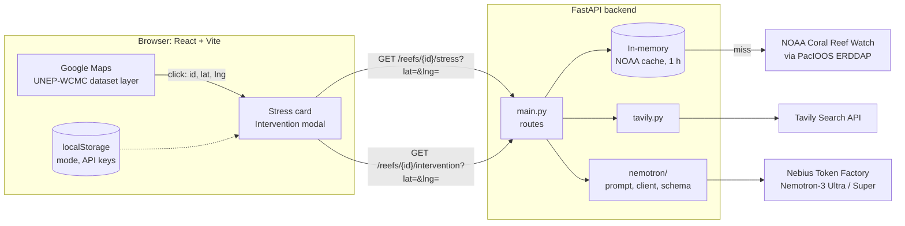
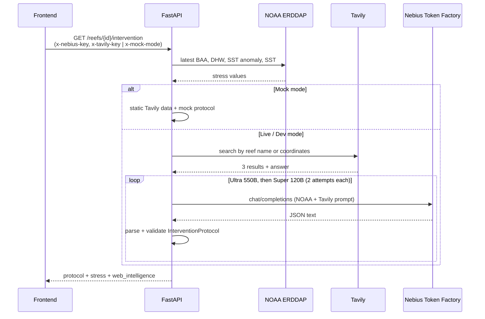

# Architecture

ThermoReef consists of a React frontend and a FastAPI backend. The backend proxies three external services: NOAA ERDDAP, Tavily Search, and Nebius Token Factory.

## Overview

## Frontend (`frontend/`)

React + TypeScript + Vite.

- **Map:** Google Maps via `@vis.gl/react-google-maps`.
- **Reef polygons & Global IDs:** UNEP-WCMC global coral reef geospatial dataset hosted in Google Maps Datasets, rendered with `getDatasetFeatureLayer` ([ReefDatasetLayer.tsx](frontend/src/components/map/ReefDatasetLayer.tsx)). The displayed `Reef #ID` (e.g., `#8270`) is the official global `OBJECTID` from the UN Environment Programme World Conservation Monitoring Centre (UNEP-WCMC) dataset, permanently attached to the vector polygon feature in Google Maps. Clicking a polygon provides both its global `OBJECTID` and exact mouse click coordinates (`lat`, `lng`).
- **Geocoding:** reverse geocoding via `google.maps.Geocoder` with in-memory caching to resolve clicked coordinates to country and region name ([geocoding.ts](frontend/src/utils/geocoding.ts)).
- **Metric tooltips:** `[i]` popups explaining NOAA satellite metrics (SST, DHW, Anomaly, Alert Level) in [NoaaStressMetrics.tsx](frontend/src/components/map/NoaaStressMetrics.tsx).
- **Stress card:** on reef selection, requests `/reefs/{id}/stress?lat=&lng=`.
- **Intervention modal:** on "Inspect Reef", requests `/reefs/{id}/intervention` and shows the protocol in tabs (Shading, Triage, Monitoring, Web Intel).
- **Settings:** three execution modes stored in `localStorage`:

| Mode | Request to backend |
|---|---|
| Mock | `?mock=true` + `x-mock-mode: true` |
| Live Cloud (own keys) | `x-nebius-key`, `x-tavily-key` headers |
| Dev | no headers, backend uses keys from `backend/.env` |

API base URL: `VITE_API_BASE` (default `http://localhost:8000`).

## Backend (`backend/src/backend/`)

FastAPI, HTTPX, Pydantic, managed with `uv`.

| File | Purpose |
|---|---|
| `main.py` | Routes, NOAA request proxy, CORS |
| `constants.py` | URLs, timeouts, model names, `.env` loading |
| `tavily.py` | Tavily search for regional reports |
| `nemotron/client.py` | Nebius API call with retry and fallback model |
| `nemotron/prompts.py` | System prompt (JSON schema) and user prompt builder |
| `nemotron/schemas.py` | Pydantic schema used to validate the protocol |
| `nemotron/mock.py` | Offline protocol for Mock mode |

### Endpoints

| Method | Path | Description |
|---|---|---|
| GET | `/reefs/{id}/stress` | Current NOAA thermal stress for clicked coordinates |
| GET | `/reefs/{id}/intervention` | Generated intervention protocol |
| GET | `/config/dev-check` | Whether `NEBIUS_API_KEY` and `TAVILY_API_KEY` are set in `.env` |
| GET | `/` | Health check |

## Request Flow

### `/reefs/{id}/stress`

1. Receive clicked coordinates (`lat`, `lng`) directly from Google Maps.
2. Query NOAA ERDDAP `dhw_5km` (PacIOOS) for the latest `CRW_BAA`, `CRW_DHW`, `CRW_SSTANOMALY`, `CRW_SST` at that ocean point.
3. If land mask encountered and `nearest=true`, search adjacent unmasked ocean pixels within 15 km.
4. Map BAA (0–4) to alert level: `normal`, `watch`, `warning`, `alert1`, `alert2`.
5. Cache result in memory for 1 hour per coordinate.

Errors: `400` if coordinates are missing; `404` if NOAA has no ocean value for the pixel; `502` if NOAA is unreachable.

### `/reefs/{id}/intervention`

1. Get NOAA stress data (same as above).
2. Search Tavily by reef name or coordinates (3 results + short answer).
3. Build prompt from NOAA values and Tavily results.
4. Call `chat/completions` on Nebius Token Factory:
   - primary model `nvidia/Nemotron-3-Ultra-550b-a55b`;
   - on failure, fallback model `nvidia/nemotron-3-super-120b-a12b`;
   - 2 attempts per model, 2 s delay on HTTP 503.
5. Strip markdown fences, parse JSON, validate against `InterventionProtocol` (Pydantic). Invalid JSON or schema mismatch counts as a failed attempt and triggers retry / fallback model.
6. Return the protocol together with stress data and Tavily results.

In Mock mode, steps 2–4 are replaced with static data; NOAA is still queried.

Errors: `400` for missing or invalid API keys; `502` for upstream failures.

## Protocol Format

Defined in `nemotron/prompts.py` and `nemotron/schemas.py`:

- `urgency_level`, `intervention_window`, `executive_summary`
- `shading`: method, target hours, expected cooling, priority
- `triage`: species at risk, donor relocation, action items
- `monitoring`: survey frequency, tools, ranger alert text

`reef_id`, `model_used`, and `generated_by` are set by the backend, not by the model.

## API Keys

- User keys are stored in the browser `localStorage` and sent as request headers. The backend does not store them.
- Without headers, the backend uses `NEBIUS_API_KEY` and `TAVILY_API_KEY` from `backend/.env`.

## Limitations

- NOAA data is resolved by reef centroid, not by full polygon.
- Caching is in-memory and resets on restart.
